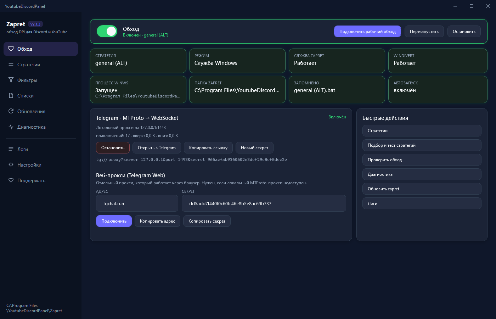
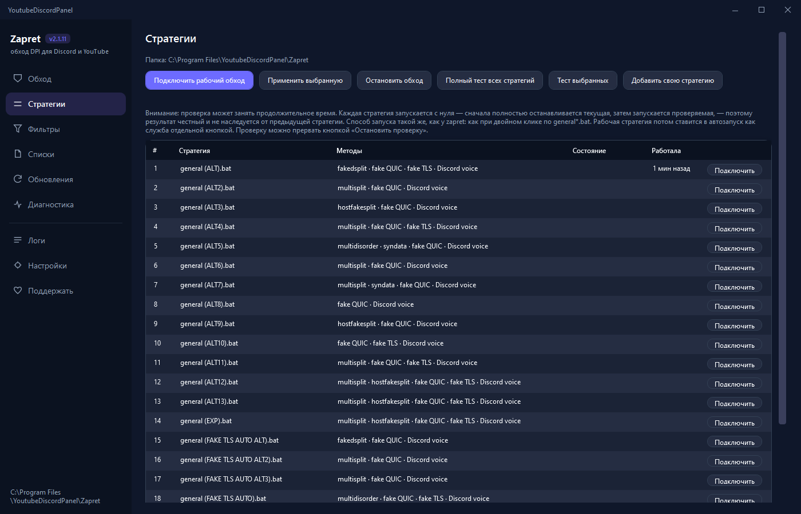
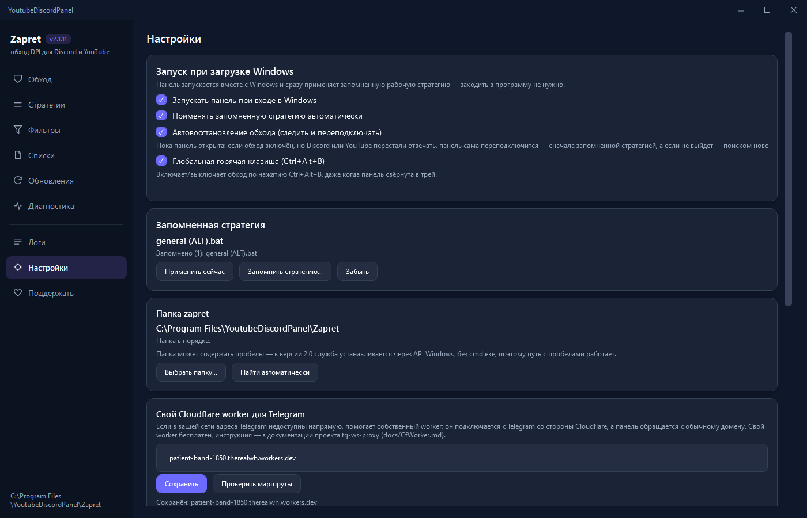
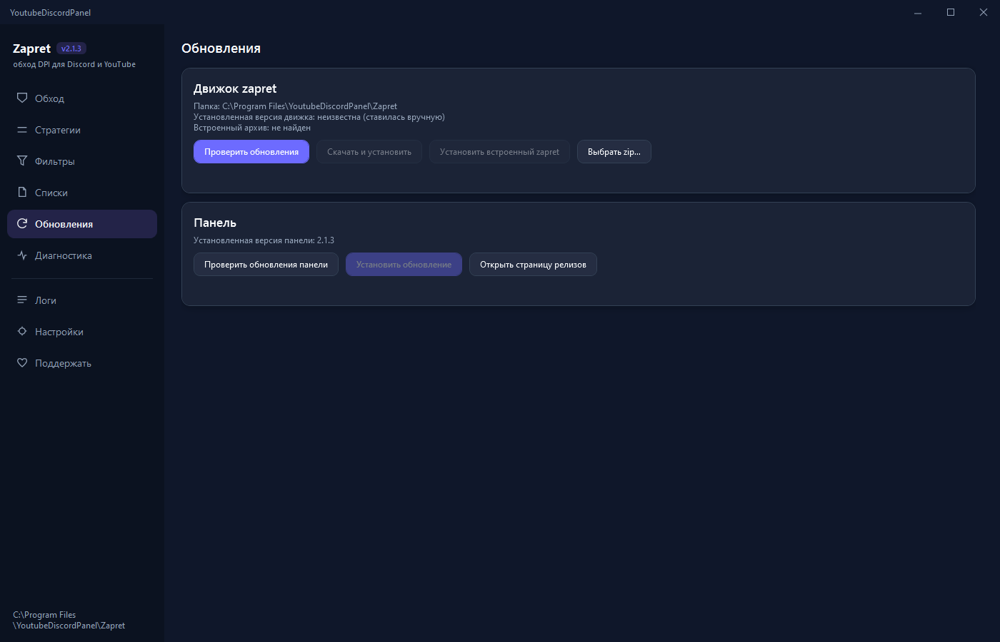

<div align="center">

# 🛡️ Zapret Panel

**Настольная панель для [zapret-discord-youtube](https://github.com/Flowseal/zapret-discord-youtube)**
**A beautiful control panel for [zapret-discord-youtube](https://github.com/Flowseal/zapret-discord-youtube)**

🎛 Обход блокировок Discord / YouTube на Windows · 📡 встроенный **MTProxy** для Telegram · 🔍 темы: `zapret`, `mtproxy`, `anti-dpi`, `obhod-blokirovok`


*Один процесс · ~90 МБ памяти · exe 280 КБ · ничего доустанавливать не нужно*

</div>

---

Настольная панель для zapret — обхода DPI, который возвращает Discord, YouTube и
Telegram при «задушенном» интернете. Панель сама находит рабочую стратегию,
ставит её службой Windows и поднимает обход при входе в систему.



## Что она делает

| | |
|---|---|
| **Находит рабочий обход сама** | Перебирает стратегии с настоящими проверками, ставит лучшую службой Windows с автозапуском и запоминает её |
| **Поднимается сама** | При входе в Windows применяет запомненную стратегию, заходить в программу не нужно |
| **Работает откуда угодно** | Папка zapret может быть на любом диске и с пробелами в пути |
| **Показывает, а не гадает** | Полный тест показывает зелёным/красным, к какой цели и по какому адресу дошло |
| **Telegram** | Встроенный прокси MTProto → WebSocket через Cloudflare-релей и свой воркер |
| **Живёт в фоне** | Сворачивается в трей, не занимает место на панели задач |

## Почему это не Electron

Версия 1.x была на Electron. Она съедала 225 МБ памяти и весила 113 МБ — дорого
для программы, которая должна тихо работать в фоне. Версия 2 переписана на C#
и WPF поверх .NET Framework 4.8, который уже есть в любой Windows.

| | Electron 1.x | Tauri (проба) | **WPF 2.x** |
|---|---|---|---|
| Процессов | 4 | 7 (WebView2) | **1** |
| Память | ~225 МБ | ~200 МБ | **~90 МБ** |
| Размер | 113 МБ | 3 МБ | **280 КБ** |
| Нужно доустанавливать | Node | WebView2 | **ничего** |

## Установка

1. Скачайте **`YoutubeDiscordPanel-Setup-latest.exe`** (~1,8 МБ)
2. Запустите его
3. Выберите **диск или папку** — программа сама создаст внутри папку
   `YoutubeDiscordPanel` и рядом с ней папку `Zapret` с движком

Больше ничего скачивать не нужно: движок zapret уже внутри установщика, интернет
не требуется. В окне установки есть галочки для ярлыков и автозапуска.

### Портативная версия

Если берёте `YoutubeDiscordPanel-latest.exe` без установщика, **движок zapret
нужно скачать отдельно** — сам exe пустой, это только панель:

1. Скачайте движок: <https://github.com/Flowseal/zapret-discord-youtube/releases>
2. Распакуйте его в любую папку, распаковывать **не в корень диска**, а в
   отдельную папку, например `D:\Zapret`
3. В панели: **Настройки → Папка zapret → Выбрать папку…** и укажите её
4. Панель запомнит путь и сама добавит домены для Telegram

Положить `zapret-bundled.zip` рядом с portable-exe тоже можно — тогда
**Обновления → Установить встроенный zapret** развернёт его сам.

## Как пользоваться

**Обход** — нажмите «Подключить рабочий обход» или щёлкните тумблер. Панель сама
подберёт стратегию и поставит её службой. Дальше при входе в Windows обход
поднимется сам.



**Полный тест** показывает всё, а не только «сработало/не сработало»: у каждой
цели зелёная или красная точка, реальный адрес, куда приземлилось соединение, и
результат по каждому протоколу.

```
● DiscordMain  https://discord.com      → 162.159.135.232  HTTP OK · TLS1.2 OK · TLS1.3 OK
●  YouTubeWeb      https://www.youtube.com  → 142.251.152.4    HTTP OK · TLS1.2 OK · TLS1.3 OK
●  CloudflareDNS1111  ping 1.1.1.1 → 1.1.1.1                  OK
```

Адрес берётся из `%{remote_ip}` самого curl — то есть это правда, а не
предположение по DNS. Во время теста можно нажать «Остановить проверку».

**Telegram** — на главной странице встроенный прокси на `127.0.0.1:1443`.
Настройки Cloudflare-релея и воркера уже заполнены, менять их нужно, только если
у вас своя инфраструктура.



Если в логах появляется «неудачных подключений за 30 секунд», значит в
настройках Telegram указан секрет **веб-прокси**, а нужен секрет **локального
MTProto-прокси** — он показан на главной странице.

**Обновления** — панель умеет обновлять и движок zapret, и саму себя.



## Страницы

| Страница | Зачем |
|---|---|
| [Обход](docs/images/01-dashboard.png) | Состояние, тумблер, Telegram, быстрые действия |
| [Стратегии](docs/images/02-strategies.png) | Список стратегий, подбор, полный тест с отчётом по адресам |
| [Фильтры](docs/images/03-filters.png) | Методы fake TLS / QUIC / fake split |
| [Списки](docs/images/04-lists.png) | Хостлисты zapret, в том числе свой `list-general-user.txt` |
| [Обновления](docs/images/05-updates.png) | Обновление движка zapret и самой панели |
| [Диагностика](docs/images/06-diagnostics.png) | Службы, драйвер, сеть, права |
| [Логи](docs/images/07-logs.png) | Журнал с фильтром по уровню и поиском |
| [Настройки](docs/images/08-settings.png) | Автозапуск, папка zapret, Cloudflare-релей и воркер |

## Требования

- Windows 10 или 11
- Права администратора — нужны для установки службы и драйвера WinDivert
- .NET Framework 4.8 — уже входит в состав Windows, ничего ставить не надо

## Сборка из исходников

```powershell
dotnet build wpf\YoutubeDiscordPanel.csproj -c Release
dotnet build wpf\setup\Setup.csproj -c Release

# 57 автотестов
.\wpf\bin\Release\net48\YoutubeDiscordPanel.exe --selftest

# проверка на папке zapret с пробелами в пути
.\wpf\bin\Release\net48\YoutubeDiscordPanel.exe --selftest --root "D:\Program Files\Zapret"
```

Релизы собирает `.github/workflows/release-wpf.yml`: он прогоняет тесты,
скачивает свежий zapret для офлайн-бандла и публикует установщик.

## Структура репозитория

```
wpf/                 текущая программа (C#, WPF, .NET Framework 4.8)
  Zapret/            движок: стратегии, установка, тесты, автоподбор
  Tg/                прокси MTProto → WebSocket
  Pages/             экраны интерфейса
  Services/          SCM, трей, логи, автообновление панели
  Theme/             тёмная тема
  setup/             установщик
  Tests/             автотесты
docs/images/         скриншоты для этого README
legacy/              версия 1.x на Electron и замеры Tauri, оставлены для справки
```

<div align="center">

## ❤️ Поддержать проект

Панель бесплатная, без рекламы и без телеметрии. Если она оказалась полезной — можно помочь.

| Сеть | Кошелёк |
|---|---|
| **USDT · TRC-20** | `TGWtYdfLEVEVXScaE4Ut7ornk1A3CXCCfe` |
| **TRX · TRON** | `TGWtYdfLEVEVXScaE4Ut7ornk1A3CXCCfe` |
| **USDT · TON** | `UQCGYVM9hg2JcqnEQpTPibPxHUuSOB03zhaSE8Yn-C2aHlH-` |
| **GRAM · TON** | `UQCGYVM9hg2JcqnEQpTPibPxHUuSOB03zhaSE8Yn-C2aHlH-` |
| **BNB · Smart Chain (BEP-20)** | `0xde5a28A77359cdCf32666Db8Aae5f5Bb13c5f886` |

В самой программе эти адреса копируются кнопкой: **Настройки → Поддержать** в боковом меню.

Спасибо! 💙

</div>

---

## Благодарность

Проект не работает сам по себе — всё держится на чужих разработках.

- **[Flowseal/zapret-discord-youtube](https://github.com/Flowseal/zapret-discord-youtube)** — **главный источник**: панель скачивает и обновляет движок только отсюда, готовые стратегии и хостлисты оттуда же
- **[bol-van/zapret](https://github.com/bol-van/zapret)** — ядро обхода DPI и `winws.exe`, установка которого требует WinDivert; панель умеет обновлять движок до любого его тега
- **[Flowseal/tg-ws-proxy](https://github.com/Flowseal/tg-ws-proxy)** — эталонная реализация MTProto → WebSocket моста для Telegram; встроенный прокси в панели написан по ней
- **[basil00/DivertWFP](https://github.com/basil00/DivertWFP)** и **[WinDivert](https://github.com/basil00/WinDivert)** — перехват сетевых вызовов, без которого zapret не запустится

Отдельно: `zapret` — проект с открытым исходным кодом, и панель является удобной
оболочкой над ним, а не заменой. Вся логика обхода принадлежит его авторам.

---

## Лицензия

MIT — см. [LICENSE](LICENSE)

Проект не связан с Telegram, Discord и YouTube и не является их клиентом.
